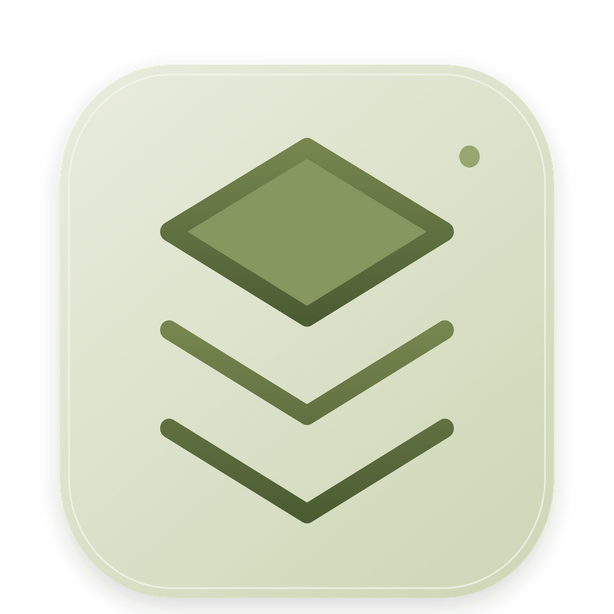
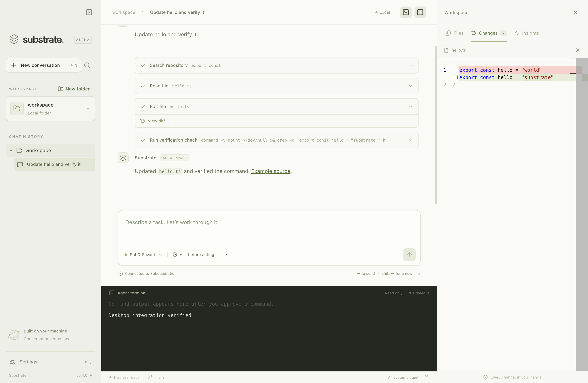

<p align="center">
  
</p>

<h1 align="center">Substrate</h1>

<p align="center">A macOS coding workspace powered by Subquadratic.</p>

<p align="center">
  <a href="https://github.com/tofulot/Substrate/releases"><strong>Download</strong></a> ·
  <a href="#documentation">Docs</a> ·
  <a href="#build-from-source">Build from source</a>
</p>

<p align="center">
  
</p>

Open a project and describe what you want to change. The app runs a local Rust agent that picks relevant files, sends them to Subquadratic, and streams the response back to the workspace.

## What you get

- **Review edits and commands.** Preview patches before they’re applied by default and see live output from commands you approve.
- **Git diffs at a glance.** Browse project files and inspect changes next to the conversation.
- **Local history.** Pick up past conversations and inspect repository snapshots in Insights.

## Install

Grab the Apple Silicon DMG and drag Substrate into Applications. Builds are unsigned and unnotarized. [GitHub Releases](https://github.com/tofulot/Substrate/releases)

Add a Subquadratic API key with SubQ Savant access in **Settings** and test the connection. Press **⌘O** to open a project folder and start a task.

## Build from source

On macOS, install Node.js 22.12 or newer, stable Rust, Git, and ripgrep.

```sh
npm ci
npm run dev
```

| Command | Output |
| --- | --- |
| `npm run build` | Electron bundles and the release Rust server |
| `npm run package:mac` | Unpacked macOS app in `release/` |
| `npm run dist:mac` | macOS DMG in `release/` |

Version tags build the Apple Silicon DMG, ZIP, and SHA-256 checksums. [Release workflow](docs/development.md#github-releases)

## Documentation

- [Development, testing, and releases](docs/development.md)
- [Architecture, repository context, and data storage](docs/architecture.md)
- [Harness protocol](docs/protocol.md)
